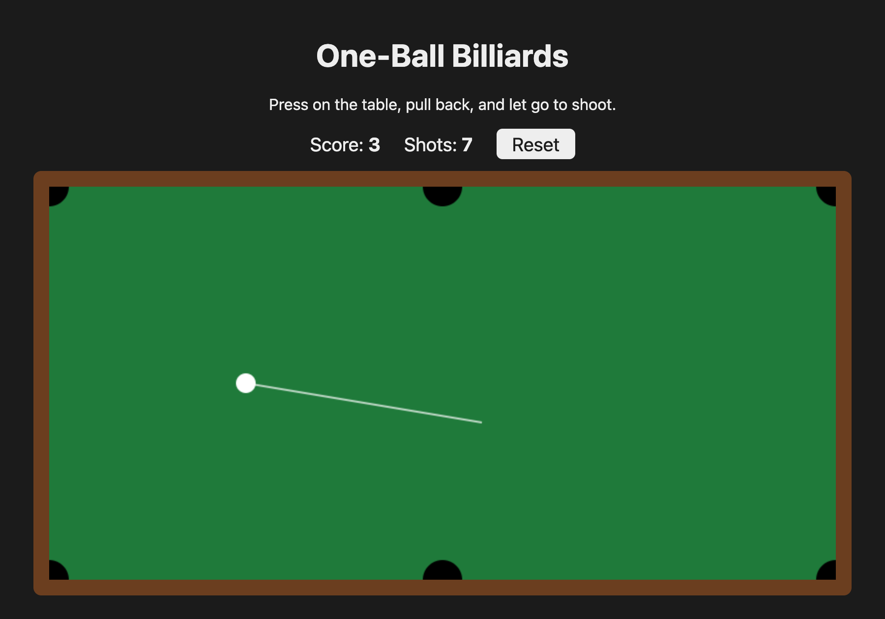

# One-Ball Billiards

A simple billiards game you play in your web browser. Pull back, let go, and watch the ball roll, bounce off the cushions and drop into the pockets.

**▶ [Play it now](https://bederson.github.io/learn-to-code/)**. It's free and there's nothing to install. It works with a mouse or a touch screen.



## How to play

1. **Press** anywhere on the table.
2. **Pull back** the way you'd pull a slingshot. A white line shows where the ball will go. The farther you pull, the harder the shot.
3. **Let go** to shoot.

The ball slows down as it rolls and bounces off the cushions. Get it into any of the six pockets to score a point, and a new ball appears on the starting spot. You can shoot again once the ball has stopped.

Your **score** (balls sunk) and **shots** (times you hit the ball) are saved in your browser, so they're still there when you come back. Press **Reset** to start over from zero.

## About this project

This game is a learning project: it was built step by step by someone learning to code for the first time. Every feature was built test-first: a small automatic test was written to describe what the code should do, then the code was written to make the test pass. [SPEC.md](SPEC.md) describes what the game should do, and [PLAN.md](PLAN.md) lists the steps it was built in.

It's written in **TypeScript**, **HTML** and **CSS**, with no game engine: the rolling, bouncing and pockets are all plain code.

## Run it on your own computer

You'll need [Node.js](https://nodejs.org) installed. Then, in a terminal:

```sh
git clone https://github.com/bederson/learn-to-code.git
cd learn-to-code
npm install          # download the tools the project uses
npm run dev          # start the game, then open the link it prints
```

Other commands:

| Command | What it does |
|---|---|
| `npm test` | Run all the tests once |
| `npm run test:watch` | Rerun the tests every time you save a file |
| `npm run typecheck` | Check the code for type mistakes |
| `npm run build` | Build the finished site into the `dist` folder |

Every push to GitHub runs the tests automatically. If they pass, the updated game is published to the [live site](https://bederson.github.io/learn-to-code/).

## What's inside

| File | What it does |
|---|---|
| [src/vector.ts](src/vector.ts) | Math for positions and speeds |
| [src/ball.ts](src/ball.ts) | Moving the ball, and friction slowing it down |
| [src/table.ts](src/table.ts) | Cushions to bounce off and pockets to fall into |
| [src/shot.ts](src/shot.ts) | Turning your pull into a shot |
| [src/game.ts](src/game.ts) | The game as a whole: score, shots, and each moment of time |
| [src/storage.ts](src/storage.ts) | Remembering the score between visits |
| [src/draw.ts](src/draw.ts) | Drawing the table and ball |
| [src/main.ts](src/main.ts) | Connecting it all to the page, the mouse and the clock |

Each `.ts` file has a matching `.test.ts` file with its tests, except the last two, which are checked by playing.
